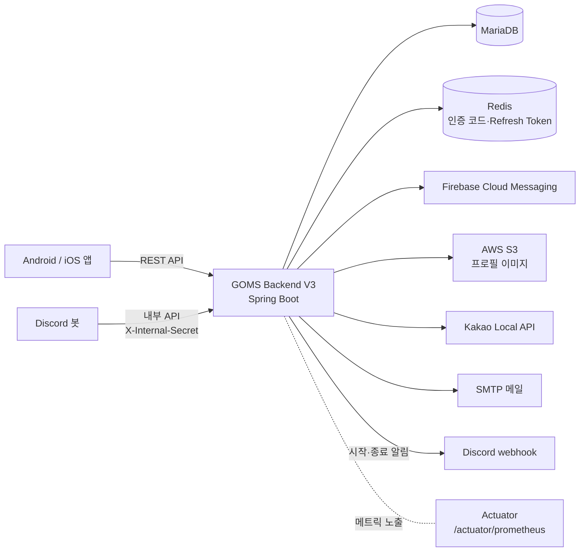

# GOMS Backend V3

GOMS(GSM Outing Management System)는 광주소프트웨어마이스터고등학교 학생들을 위한 외출제 관리 서비스입니다. QR 코드를 활용한 외출·복귀 관리, 실시간 외출 현황 조회, 주변 장소 탐색과 추천을 제공합니다. 이 저장소는 Android·iOS 앱과 Discord 봇이 사용하는 GOMS V3 API 서버입니다.


## 주요 기능

| 영역 | 서버 기능 |
| --- | --- |
| 인증·계정 | 이메일 인증, 회원가입, 로그인, JWT 재발급·로그아웃, 비밀번호 변경, 회원 탈퇴 |
| 외출 | QR 외출·복귀(QR 만료·학년별 외출 시작 시각 검증), 내 외출 상태, 외출 학생 목록·수·검색 |
| 학생회 | 회원 조회·필터, 권한 변경, 외출 허용 설정, 강제 외출·복귀, QR 발급, 지각 목록, 신고 처리 |
| 지각 | 지각 랭킹 조회, 미복귀 외출의 지각 자동 처리 |
| 장소 | 장소 목록·상세·검색, 핫플레이스, 추천·추천 취소, Kakao 장소 데이터 동기화 |
| 후기·신고 | 장소 후기 작성·삭제, 후기 신고와 내 신고 조회 |
| 알림 | FCM 기기 토큰 등록·삭제, 복귀 시간 알림 푸시, 영구 무효 토큰만 정리하는 발송 실패 처리 |
| Discord 연동 | Discord 봇이 호출하는 학생회 권한 반영 내부 API, 서버 시작·종료 webhook 알림 |
| 회원 프로필 | 프로필 조회, S3 프로필 이미지 업로드·삭제 |

스케줄러는 다음 작업을 실행합니다.

- `LateAutoCreateJob`: 월·수 19:30에 미복귀 외출을 복귀 처리하고 지각을 기록합니다.
- `OutingReminderPushJob`: 월·수에 외출 중인 학생에게 복귀 알림 푸시를 보냅니다.
- `PlaceSyncScheduler`: 정해진 날 04:00에 Kakao 장소 데이터를 동기화합니다.

## 기술 스택

| 분류 | 사용 기술 |
| --- | --- |
| Language·Framework | Kotlin 2.2, Java 21, Spring Boot 4.0 (Web MVC, Validation, WebClient) |
| 인증 | Spring Security, JWT(jjwt) |
| 데이터 | Spring Data JPA, MariaDB, Redis |
| 외부 연동 | Firebase Admin(FCM), AWS S3, Kakao Local API, Discord webhook, SMTP 메일 |
| 문서·모니터링 | Springdoc OpenAPI, Spring Boot Actuator, Micrometer Prometheus |
| 테스트 | Kotest, MockK, H2, Testcontainers(MariaDB·Redis) |
| 빌드·배포 | Gradle Wrapper, Docker Compose, GitHub Actions |

## Architecture

서버 기준의 개념적 구성입니다. 실제 배포 토폴로지와 다를 수 있습니다.



- Discord 봇은 서버의 내부 API(`/api/v3/internal/student-council/discord/apply`)를 호출하고, 서버는 별도로 Discord webhook에 서버 시작·종료를 알립니다.
- 서버는 Actuator로 Prometheus 형식의 메트릭을 노출합니다. 메트릭 수집·시각화 설정은 이 저장소에 포함되어 있지 않습니다.

## 프로젝트 구조

`src/main/kotlin/com/teamharibo/goms`

```text
domain/   auth, member, outing, studentcouncil, late, place,
          review, report, notification, discord, s3, health, common
global/   config, security, jwt, exception, log, discord, util
```

- `domain/*`: 기능별 패키지입니다. 일반적으로 `controller` → `service`(인터페이스) → `service/impl` → `repository` → `entity` 순서로 호출하고, `dto`, `exception`, `util`을 함께 둡니다.
- `domain/studentcouncil`: 학생회 전용 API로, 다른 도메인의 repository와 entity를 사용합니다.
- `domain/*/job`, `domain/place/scheduler`: 스케줄러 작업입니다.
- `global/security`, `global/jwt`: Security 설정, JWT 발급·검증 필터, 인증·인가 실패 응답을 담당합니다.
- `global/exception`: `GlobalException`, `ErrorCode`, `GlobalExceptionHandler`로 공통 오류 응답을 만듭니다.
- `global/config`: Redis, S3, Firebase, CORS, OpenAPI, Clock, 스케줄러 등 설정입니다.

## Getting Started

### 요구 사항

- JDK 21
- Gradle은 별도로 설치하지 않고 Wrapper(`./gradlew`, Windows는 `gradlew.bat`)를 사용합니다.
- MariaDB, Redis. 로컬에서는 Docker Compose로 띄울 수 있습니다.

### 1. MariaDB·Redis 실행

`docker-compose.yml`은 운영 배포용 구성(app·mariadb·redis)입니다. 로컬에서는 DB와 Redis만 띄웁니다. Compose는 `REDIS_PASSWORD`가 없으면 실행되지 않습니다.

```bash
export DB_NAME=goms DB_USERNAME=goms DB_PASSWORD=<로컬용 비밀번호> \
       REDIS_PASSWORD=<로컬용 비밀번호> TZ=Asia/Seoul
docker compose up -d mariadb redis
```

### 2. 환경변수 설정

기본 프로필은 `prod`(`SPRING_PROFILES_ACTIVE` 미지정 시)입니다. `dev`·`prod` 프로필은 아래 값을 환경변수로 받으며, 대부분 기본값이 없어 비어 있으면 서버가 시작되지 않습니다. 변수 이름 목록은 [`.env.example`](.env.example)을 참고합니다. `.env.example`은 운영 Compose 입력 기준이므로 로컬 기본값으로 쓰지 않습니다.

| 분류 | 변수 |
| --- | --- |
| DB | `DB_HOST`, `DB_PORT`, `DB_NAME`, `DB_USERNAME`, `DB_PASSWORD` |
| Redis | `REDIS_HOST`, `REDIS_PORT`, `REDIS_PASSWORD`(Compose와 같은 값) |
| JWT | `JWT_SECRET`, `JWT_ACCESS_EXP_SECONDS`, `JWT_REFRESH_EXP_SECONDS` |
| 메일 | `MAIL_HOST`, `MAIL_PORT`, `MAIL_USERNAME`, `MAIL_PASSWORD` |
| FCM | `FCM_CREDENTIALS_JSON`(Firebase 서비스 계정 JSON) |
| S3 | `AWS_ACCESS_KEY`, `AWS_SECRET_KEY`, `AWS_REGION`, `AWS_S3_BUCKET` |
| 외부 연동 | `KAKAO_REST_API_KEY`, `DISCORD_WEBHOOK_URL`, `DEPLOY_ENV`, `GOMS_INTERNAL_API_SECRET` |

- 메일, S3, Kakao, Discord 값은 서버 시작 시점에는 외부 호출을 하지 않으므로 로컬에서는 개발용 값이나 임의 값으로 시작할 수 있습니다. 해당 기능을 호출하면 실패합니다.
- FCM은 시작 시점에 서비스 계정 JSON을 파싱하므로 개발용 Firebase 프로젝트의 올바른 JSON이 필요합니다.
- 현재 `dev` 프로필은 `fcm.credentials-path`(`FCM_CREDENTIALS_PATH`)를 정의하지만 `FirebaseConfig`는 `fcm.credentials-json`을 읽습니다. 이 불일치가 해결되기 전까지 `dev` 프로필은 FCM 설정을 찾지 못해 시작되지 않습니다.
- 실제 credential은 저장소에 커밋하지 않습니다.

### 3. 실행·테스트

```bash
export SPRING_PROFILES_ACTIVE=prod   # 미지정 시에도 prod
./gradlew bootRun                     # Windows: gradlew.bat bootRun
./gradlew test
```

로컬 실행은 위 환경변수가 모두 준비된 경우에만 가능하며, 저장소 기본 설정만으로 바로 실행되지는 않습니다.

## API · Test · Documentation

- **API 문서**: 서버 실행 후 `/swagger-ui.html`(Swagger UI), `/v3/api-docs`(OpenAPI JSON). 두 경로는 인증 없이 접근할 수 있고, 프로필 설정으로 비활성화하지 않습니다. 경로는 `SPRINGDOC_API_DOCS_PATH`, `SPRINGDOC_SWAGGER_UI_PATH`로 바꿀 수 있습니다.
- **헬스 체크·메트릭**: `/actuator/health`, `/actuator/info`, `/actuator/prometheus`
- **테스트**: `./gradlew test`. Testcontainers를 쓰는 MariaDB·Redis 통합 테스트는 Docker가 없으면 건너뜁니다.
- **CI**: GitHub Actions가 PR과 `develop`·`main` push에서 `./gradlew build --no-daemon`을 실행합니다.
- **설정 계약 검사**: Spring Config Contract 파일럿의 실행 방법과 결과는 [설정 계약 검사 문서](docs/config-contract.md)를 참고합니다.

## Engineering

운영과 리뷰에서 확인한 문제를 PR 단위로 개선했습니다. 수치는 각 PR 본문에 기록된 검증 조건 기준입니다.

- **외출 상태 동시성** ([#67](https://github.com/team-haribo/GOMS-Backend-V3/pull/67), [#94](https://github.com/team-haribo/GOMS-Backend-V3/pull/94)): QR·학생회 강제 외출 경합과 외출 허용 변경·지각 작업 경합을 회원 비관적 락으로 통일했습니다.
- **Refresh Token 경합** ([#127](https://github.com/team-haribo/GOMS-Backend-V3/pull/127)): 재발급과 로그아웃을 Redis Lua 원자 연산으로 처리해, 실행 순서를 강제한 재현 시나리오에서 세션 부활·이중 발급이 10/10에서 0/10이 되었습니다.
- **추천 장소 N+1** ([#117](https://github.com/team-haribo/GOMS-Backend-V3/pull/117)): JOIN 단일 쿼리로 바꿔 활성 추천 10개 기준 SELECT 수를 13회에서 3회로 줄였습니다(H2, Hibernate Statistics 기준).
- **장소 동기화 트랜잭션** ([#69](https://github.com/team-haribo/GOMS-Backend-V3/pull/69)): 최대 1,176회의 Kakao API 호출 동안 DB 커넥션을 점유하지 않도록 외부 호출과 DB 반영의 트랜잭션을 분리했습니다.
- **5xx 응답 정리** ([#131](https://github.com/team-haribo/GOMS-Backend-V3/pull/131), [#132](https://github.com/team-haribo/GOMS-Backend-V3/pull/132)): 운영 로그에서 확인한 만료 토큰 재발급·잘못된 경로 요청의 500 응답을 401·404 등 클라이언트 오류로 바로잡았습니다.

## 관련 저장소

- [GOMS-Android-V3](https://github.com/team-haribo/GOMS-Android-V3)
- [GOMS-iOS-V3](https://github.com/team-haribo/GOMS-iOS-V3)
- [GOMS-Bot-V1](https://github.com/team-haribo/GOMS-Bot-V1)

## 기여하기

기여에 관심이 있으시다면 [기여자 행동 강령 규약](CODE_OF_CONDUCT.adoc)을 먼저 읽어주시고, 이슈를 생성하거나 PR을 보내주세요.

## 라이선스

이 프로젝트는 MIT 라이선스를 따릅니다. 자세한 내용은 [LICENSE](LICENSE) 파일을 참고하세요.
